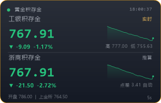

# 黄金积存金桌面卡片 · GoldDock

一个常驻桌面最上层的迷你卡片，实时显示 **工银积存金** 和 **浙商积存金** 的价格与 **当日涨跌幅**（相对当日开盘价）。
单文件 exe，免安装、零依赖，Windows 10 x64 直接跑。



---

## 特性

- **始终置顶**：`TopMost` 无边框卡片，不会被其它窗口遮挡
- **随时可拖**：左键按住卡片任意位置就能移动，窗口有没有焦点、有没有被盖住都能拖；位置自动记忆
- **涨跌看当日开盘价**：`跌幅 = (现价 − 当日开盘价) ÷ 当日开盘价`，红涨绿跌
- **迷你走势图**：每行右侧一条当日 sparkline，y 轴有最小跨度，不会被噪声放大成"山峰"
- **紧凑模式**：双击卡片切换，高度减半
- **跌幅提醒**：当日跌幅超过阈值时边框闪烁 + 托盘气泡（阈值可调，填 0 关闭）
- **外观自定义**：深色 / 浅色 / 金色 / 全透明 四套预设，背景、文字、上涨色、下跌色都能改
- **完全透明背景**：`WS_EX_LAYERED + UpdateLayeredWindow` 逐像素 alpha，
  0% 不透明度时只留数字浮在桌面上，**整块区域仍然可以用鼠标点中拖动**（不是色键透明那种会丢鼠标事件的方案）
- **ESC 立即退出**：低级键盘钩子，只在鼠标悬在卡片上或卡片是活动窗口时生效，不抢全系统 ESC
- **托盘图标 / 开机自启 / 刷新间隔可选（3~60 秒）**

---

## 下载使用

到 [Releases](../../releases) 下载 `GoldDock.exe`，双击即可。
需要 .NET Framework 4.x —— Windows 10 自带，无需安装任何东西。

右键卡片有完整菜单；详细说明见 [`docs/使用说明.txt`](docs/使用说明.txt)。

---

## 数据从哪来

| 产品 | 来源 | 说明 |
|---|---|---|
| 工银积存金 | 工商银行网银公开行情接口 `mybank.icbc.com.cn/servlet/AsynGetDataServlet`（`tranCode=A00622`） | 官方实时报价，角标显示「实时」 |
| 浙商积存金 | **无公开接口** → 按「上金所 Au99.99 + 点差」推算 | 角标显示「推算」，点差可自动/手动设置 |
| 上金所 Au99.99 | 新浪财经 `hq.sinajs.cn/list=gds_AU9999`（主源）/ 东方财富 `push2.eastmoney.com`（备源） | 实时价、当日高低 |
| 上金所当日开盘 | 东方财富 1 分钟 K 线 `push2his.eastmoney.com`，取当天 `09:01` 第一根 | 日盘开盘价，如 786.00 |

### 关于浙商积存金

浙商银行没有公开的实时报价接口（网页 404、行情站 502、域名不解析都试过），
所以按 `浙商价 = 上金所 Au99.99 + 点差` 推算。点差默认「自动」——
用「工行报价 − 上金所报价」的实时中位数估出来，因为你手机上看到的工行价就是一个天然样本。

**为什么这样也够用**：点差在一日内近似固定、且是加性常数，
所以 *(现价 − 基准) / 基准* 这个**涨跌幅与点差取值无关**，而"监视跌幅"正是本程序的目的。
如果你知道浙商的实际点差，右键「浙商点差…」填进去即可。

### 关于"当日开盘价"

上金所行情里的"今开"是**前一晚 20:01 夜盘**的开盘价（今天实测 803.90），
而工行、浙商的积存金报价都不含夜盘 —— 直接套用会把跌幅放大一倍多。
所以基准统一取 **上金所日盘 09:01 的第一笔成交价**（今天 786.00）+ 各自点差，
并且保证不越出各行自己当日的最高/最低区间（开盘不可能比当日最高还高）。

---

## 从源码构建

只需要 Windows 自带的 .NET Framework 4.x 编译器，不需要 Visual Studio / .NET SDK：

```powershell
powershell -ExecutionPolicy Bypass -File build.ps1
```

产物：`dist\GoldDock.exe`（约 55 KB）。

自检命令：

```powershell
GoldDock.exe --selftest out.txt     # 把两个数据源的取数结果写到 out.txt
GoldDock.exe --snapshot out.png     # 把卡片渲染成 png（不显示窗口）
```

---

## 代码结构

```
src/Json.cs      C#5 兼容的手写 JSON 解析器（不引第三方库）
src/Sources.cs   行情抓取：工行 POST 接口、上金所（新浪/东财）、当日开盘价
src/Config.cs    ini 配置（落盘位置：exe 同目录 → %APPDATA% → %TEMP%）
src/Native.cs    分层窗口 UpdateLayeredWindow、ESC 键盘钩子、颜色工具
src/Program.cs   CardForm 全部绘制、交互、菜单、托盘、定时刷新
build.ps1        调用 csc.exe 编译
```

因为用 `csc.exe` 直接编译，源码限制在 **C# 5** 语法（不能用 `$""`、`?.`、`nameof` 等）。

---

## 已知限制

- **仅 Windows**（WinForms + P/Invoke）
- 工行接口是网银页面背后的公开接口，不是正式 API，可能随时变更或限流
- 浙商价为推算值，绝对价格可能有偏差（涨跌幅不受影响）
- 行情来自第三方，可能有延迟或中断

---

## 免责声明

本项目仅供学习与个人参考，行情数据来自第三方公开接口，可能存在延迟、错误或中断，
**不构成任何投资建议**。据此操作，风险自负。

## License

[MIT](LICENSE)
